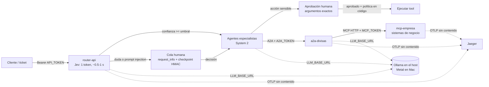

# Arquitectura, inventario y orden — guía para aprender

Un solo repositorio (`jackthony/IA-local`, privado) con tres áreas que construyen una encima de otra.
Inventario vivo de la máquina: `uv run python scripts/inventario.py` → `INVENTARIO.md`.

```
IA-local/
├── labs/        11 patrones de agentes (01 tools … 11 aprobación humana) + common.py + empresa.py
├── jev/         Decisiones tipadas con probabilidad calibrada (System 1): núcleo, ingesta, evaluación
├── servicios/   Producción: router-api, a2a-divisas, mcp-empresa (+ seguridad, telemetría)
├── scripts/     Escáner de secretos, generador de .env, inventario
├── experimentos/ Cómo se descubrió cada decisión (prototipos y mediciones)
├── openspec/    Specs vigentes (openspec/specs) e historial de cambios (openspec/changes/archive)
├── data/        Datasets verificados por SHA-256 + calibración + licencias (el estado de ejecución NO va a git)
├── modelos.json Manifiesto de modelos por digest (los modelos NO van a git)
├── Dockerfile · compose.yaml · .github/workflows/tests.yml
```

## El sistema completo



Principio que atraviesa todo: **la estructura y las decisiones de riesgo viven en código; el LLM aporta
contenido**. Cada vez que se dejó algo al prompt (turnos, términos, "no inventes", "usa la tool") falló
con modelos chicos, y se movió a código (selector, `ExigeTool`, `umbral_auto`, `validar_reembolso`).

## Qué patrón usar y cuánto cuesta (medido en CPU)

| Necesidad | Patrón (lab) | Costo medido | Riesgo típico |
|---|---|---|---|
| Una tarea con datos | Agente + tools (01) | ~10 s | Cálculos inventados → tools deterministas |
| Pasos fijos / paralelos | Secuencial, concurrente (02) | ~80 s | — |
| Derivar a especialista | Handoff (03) | ~45 s | Ping-pong en malla → estrella + límites |
| Agentes en otros equipos | A2A (04-05) | ~40 s | Auth entre servicios (servicios/) |
| Debate / comité | Group chat (06) | ~2-3 min | Roles se desvían, evidencia inventada |
| Tarea abierta multi-paso | Magentic (07) | **~18 min** | El más caro; usar solo si el flujo no se conoce |
| Sistemas compartidos | MCP con mínimo privilegio (08-09) | ~45 s | Restringir tools no restringe al modelo |
| Clasificar / rutear rápido | **Jev** (jev/, 10) | **0.5-1 s** | Calibrar; el prompt es un hiperparámetro |
| Humano en el circuito | HITL reanudable (11) | + tiempo humano | Checkpoints con pickle → sellar |

## Credenciales: qué existe, dónde vive y qué nunca va a git

| Credencial | Dónde | Para qué | Rotación |
|---|---|---|---|
| `API_TOKEN`, `A2A_TOKEN`, `MCP_TOKEN` | `.env` por máquina (gitignored) | Auth entre servicios | Borrar `.env` → `scripts/generar_env.py` |
| Clave HMAC | `~/.ia-local/hitl.key` | Sellar checkpoints del lab 11 | Borrarla invalida checkpoints pendientes |
| Cuenta GitHub dueña del repo | keyring de `gh` | Clonar/push del repo privado | `gh auth login` / `gh auth logout` |

Nunca en el repo: `.env`, claves, tokens de cuentas, el estado de ejecución (`data/hitl/`, logs,
correcciones). El CI bloquea tokens con patrones conocidos (`scripts/escanear_secretos.py`).
No se usan APIs de pago ni claves de nube: todo corre local.

## Orden en la Mac: un solo almacén de modelos para todos tus proyectos

Los modelos de Ollama **no son por proyecto**: viven en un almacén por máquina y cualquier proyecto
los usa por nombre. Para tener orden con tus otros trabajos, una sola raíz:

```
~/IA/
├── modelos/ollama/        ← OLLAMA_MODELS (todos los proyectos; blobs deduplicados)
├── modelos/huggingface/   ← HF_HOME (si usas Transformers/MLX en otros proyectos)
├── datasets/              ← opcional: datasets compartidos con su manifiesto SHA-256
└── proyectos/IA-local/    ← este repo (y tus otros proyectos al lado)
```

1. **Primero mira qué tienes**: clona el repo y corre `uv run python scripts/inventario.py`. La tabla
   "Almacenes detectados" muestra Ollama, Hugging Face y LM Studio con su tamaño, y "otros modelos
   locales" lista los de tus otros proyectos (no se tocan).
2. **Si quieres mover el almacén de Ollama** a `~/IA/modelos/ollama` (opcional): cierra la app de Ollama,
   mueve la carpeta, y con la app de macOS define la variable como indica la FAQ de Ollama:
   `launchctl setenv OLLAMA_MODELS "$HOME/IA/modelos/ollama"`; reabre Ollama. Verifica con
   `ollama list` y el inventario **antes** de borrar nada. (`launchctl setenv` no sobrevive a un
   reinicio: repítelo o agrégalo a un LaunchAgent/perfil si lo adoptas.)
3. **Instala lo de este proyecto**: `ollama pull qwen3:4b-instruct` (obligatorio) y `qwen3:8b` (opcional);
   el inventario confirma que los digests coinciden con `modelos.json` (lo mismo que se probó aquí).

## Siguiente nivel en la MacBook (M5 Pro)

Con memoria unificada y GPU Metal, Ollama corre los mismos modelos mucho más rápido que esta CPU, y
caben modelos más grandes. El inventario lista los candidatos que caben en **tu** RAM. Tamaños medidos
en el registro de Ollama (2026-09-29):

| Modelo | Descarga | RAM sugerida | Para qué en este repo |
|---|---|---|---|
| `qwen3:14b` | 9.3 GB | ≥24 GB | Agentes y Jev más exactos |
| `gpt-oss:20b` | 13.8 GB | ≥32 GB | Razonamiento / manager de Magentic |
| `qwen3:30b-a3b` | 18.6 GB | ≥36 GB | MoE: calidad ~30B a velocidad cercana a 4B (Magentic, group chat) |
| `qwen3-coder:30b` | 18.6 GB | ≥36 GB | Agentes de código |
| `qwen3:32b` | 20.2 GB | ≥48 GB | Máxima calidad local (denso, más lento) |
| `qwen3-embedding:0.6b` | 0.6 GB | ≥8 GB | RAG: siguiente tema (grounding con documentos) |

Cómo adoptarlos sin adivinar (el método de todo el proyecto):
1. `ollama pull <modelo>` y agrégalo a `modelos.json` con su digest (lo ves en `ollama list`).
2. Mide: `LLM_MODEL=<modelo> uv run python jev/eval_bitext.py` y `jev/evaluar_empresa.py` (exactitud,
   ECE, % automatizable). Para agentes: re-corre el lab relevante (p. ej. `MANAGER_MODEL=qwen3:30b-a3b`
   en el lab 07).
3. Adopta solo si mejora la métrica que importa; si no, el 4B sigue siendo el default barato.

## Ruta de aprendizaje sugerida

1. Labs 01 → 05 (agentes, orquestación, A2A) y sus lecciones en el README.
2. Labs 06 → 09 (conversación entre agentes, Magentic, MCP) — dónde fallan los modelos chicos.
3. `jev/README.md` + `experimentos/` — medir en vez de suponer; calibración; diagnóstico de datos.
4. Labs 10 → 11 — System 1 + System 2 + humano; seguridad en profundidad.
5. `servicios/` + `compose.yaml` — producción: auth entre servicios, contenedores endurecidos, trazas.
6. `openspec/` — cada cambio empezó como spec con escenarios verificables y terminó con un test.
